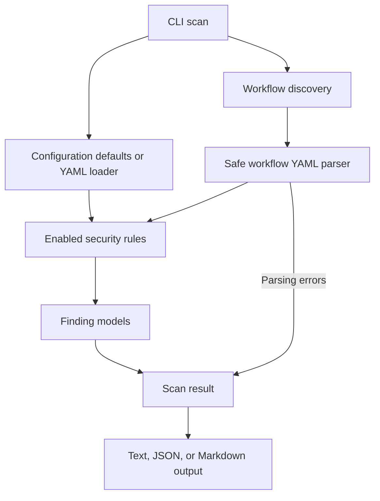

# Scan Architecture

The CLI loads optional rule configuration separately from workflow parsing, then
discovers and analyzes local workflows. Findings and parsing errors feed the
selected text, JSON, or Markdown output.

See the [CLI](../../src/jc_github_action_security_auditor/cli.py),
[configuration](../../src/jc_github_action_security_auditor/config.py), and
[reporting models](../../src/jc_github_action_security_auditor/reporting.py).
