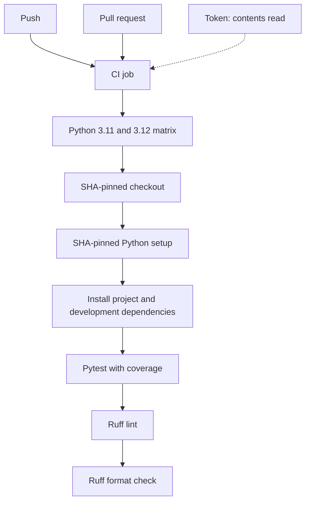

# CI Pipeline

The configured [CI workflow](../../.github/workflows/ci.yml) runs on push and
pull requests with read-only contents permission. Checkout and Python setup use
full SHA pins. The diagram describes configuration, not hosted run results.

