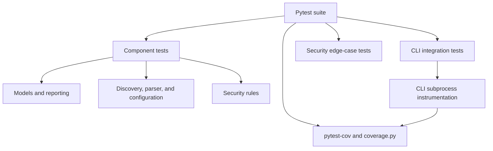

# Testing Layers

The [test suite](../../tests/) exercises individual components and the CLI.
Coverage includes subprocess instrumentation for CLI tests; it measures executed
statements rather than proving security or branch completeness.

Coverage settings are in [pyproject.toml](../../pyproject.toml).
